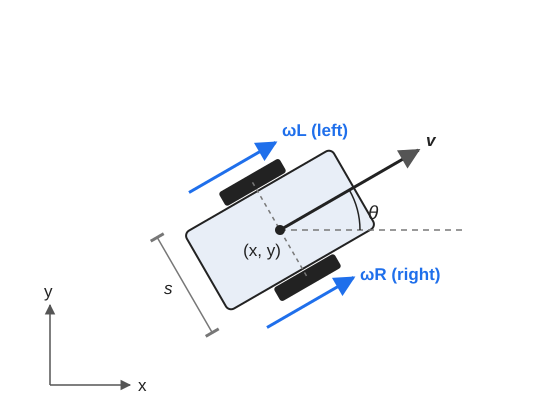

# DifferentialDriveRobot Kinematics

This page explains how the motion in [`DifferentialDriveRobot.py`](../Robot2DStudio/Robot/Models/DifferentialDriveRobot.py) is derived and how it is written in state-space form.

Unlike the other models, this one is **kinematic**: it has no forces or masses, and its inputs are wheel velocities. That's why it uses `DifferentialKinematics` instead of `Dynamics`.

## Model

The robot moves on a plane, driven by two wheels on a common axle. It turns by spinning the wheels at different speeds.

Assumptions:

- The wheels roll without slipping.
- The robot can't move sideways.
- The wheel velocities change instantly, with no motor limits or response time.
- Each input is held constant during an integration step.

Sign conventions: `θ` is measured from the world `x` axis and is positive counterclockwise.

## State, input and parameters

$$
X = \begin{bmatrix} x & y & \theta \end{bmatrix}^T
\qquad
u = \begin{bmatrix} \omega_L & \omega_R \end{bmatrix}^T
$$

`(x, y)` is the center of the axle. `ωL` and `ωR` are the angular velocities of the left and right wheels.

| Symbol | Code | Meaning |
|---|---|---|
| $s$ | `s` | Distance between the wheel centers |
| $r$ | `r` | Radius of the wheels |

## Derivation

### Wheel speeds

A wheel rolling without slipping moves its center at:

$$
v_L = r\,\omega_L
\qquad
v_R = r\,\omega_R
$$

### Forward speed

The center of the axle is halfway between the wheels, so its speed is their average:

$$
v = \frac{v_R + v_L}{2} = \frac{r}{2}(\omega_R + \omega_L)
$$

### Turning rate

If the wheels move at different speeds, the axle rotates. The speed difference across the distance $s$ gives the turning rate:

$$
\dot{\theta} = \frac{v_R - v_L}{s} = \frac{r}{s}(\omega_R - \omega_L)
$$

So a faster right wheel turns the robot counterclockwise.

### Motion in the world frame

The robot moves along its heading, so the forward speed splits between the world axes:

$$
\dot{x} = v\cos\theta
\qquad
\dot{y} = v\sin\theta
$$

Since the robot can't move sideways, its velocity always satisfies:

$$
\dot{x}\sin\theta - \dot{y}\cos\theta = 0
$$

## State-space form

Combining these gives:

$$
\dot{X} = J(X)\,u
$$

where $J$ is the Jacobian in the code:

$$
J = r\begin{bmatrix}
\dfrac{\cos\theta}{2} & \dfrac{\cos\theta}{2} \\[6pt]
\dfrac{\sin\theta}{2} & \dfrac{\sin\theta}{2} \\[6pt]
-\dfrac{1}{s} & \dfrac{1}{s}
\end{bmatrix}
$$

In the form used by the other models, $\dot{X} = A\,X + B(X)\,u + E$, this means $A = 0$, $B(X) = J(X)$ and $E = 0$.

The state only changes through the input, so the robot stops as soon as $u = 0$. The model is **nonlinear** because $J$ depends on $\theta$.

## Limitations

- **No dynamics:** mass, inertia and motor torque are ignored, so the robot has no momentum and can change speed instantly.
- **No slip:** the model doesn't apply when the wheels skid, for example during hard acceleration or on a low-grip surface.
- **Ideal wheels:** both wheels are assumed to have the same radius, and the axle to pass through `(x, y)`.
