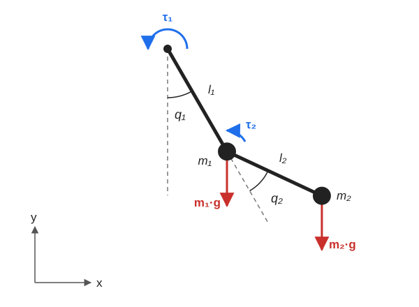

# DoublePendulum Dynamics

This page explains how the dynamics in [`DoublePendulum.py`](../Robot2DStudio/Robot/Models/DoublePendulum.py) are derived and how they are written in state-space form.

## Model

The double pendulum swings in a plane around a fixed pivot. It is modeled as two point masses at the ends of two rigid links in series.

Assumptions:

- The links have negligible mass, so all the mass is at their ends.
- There is no damping or friction.
- Each input is held constant during an integration step.

Sign conventions: both angles are positive counterclockwise. `q1` is measured from the downward vertical. `q2` is measured from the direction of the first link, so it is a relative angle. `q1 = q2 = 0` is hanging straight down.

## State, input and parameters

$$
X = \begin{bmatrix} q_1 & q_2 & \dot{q}_1 & \dot{q}_2 \end{bmatrix}^T
\qquad
u = \begin{bmatrix} \tau_1 & \tau_2 \end{bmatrix}^T
$$

`τ1` is the torque at the first joint and `τ2` is the torque at the second joint.

| Symbol | Code | Meaning |
|---|---|---|
| $l_1,\ l_2$ | `l1`, `l2` | Length of the first and second link |
| $m_1,\ m_2$ | `m1`, `m2` | First and second mass |
| $g$ | `g` | Gravity acceleration |

## Derivation

The two links are coupled, so it is easier to start from energy than from forces. This is the Lagrangian method.

### Positions

$$
p_1 = \begin{bmatrix} l_1\sin q_1 \\ -l_1\cos q_1 \end{bmatrix}
\qquad
p_2 = p_1 + \begin{bmatrix} l_2\sin(q_1 + q_2) \\ -l_2\cos(q_1 + q_2) \end{bmatrix}
$$

### Energy

Differentiating the positions gives the speeds of the masses, and from them the kinetic energy:

$$
T = \tfrac{1}{2}m_1 l_1^2\dot{q}_1^2
+ \tfrac{1}{2}m_2\left[l_1^2\dot{q}_1^2 + l_2^2(\dot{q}_1 + \dot{q}_2)^2 + 2 l_1 l_2\dot{q}_1(\dot{q}_1 + \dot{q}_2)\cos q_2\right]
$$

The potential energy comes from the height of each mass:

$$
U = -m_1 g l_1\cos q_1 - m_2 g\left[l_1\cos q_1 + l_2\cos(q_1 + q_2)\right]
$$

### Equations of motion

With $L = T - U$, the Euler-Lagrange equation for each angle is:

$$
\frac{d}{dt}\frac{\partial L}{\partial \dot{q}_i} - \frac{\partial L}{\partial q_i} = \tau_i
$$

Working these out and collecting the terms gives:

$$
M(q)\,\ddot{q} + C(q,\dot{q})\,\dot{q} = u + G(q)
$$

So the accelerations are:

$$
\ddot{q} = M(q)^{-1}\left(u - C(q,\dot{q})\,\dot{q} + G(q)\right)
$$

## The matrices

### Mass matrix

$M$ tells how hard each joint is to accelerate, and how the two joints affect each other:

$$
M = \begin{bmatrix}
(m_1 + m_2)l_1^2 + m_2 l_2^2 + 2 m_2 l_1 l_2\cos q_2 & m_2 l_2^2 + m_2 l_1 l_2\cos q_2 \\
m_2 l_2^2 + m_2 l_1 l_2\cos q_2 & m_2 l_2^2
\end{bmatrix}
$$

It can always be inverted when the masses and lengths are positive, because its determinant is:

$$
\det M = m_2 l_1^2 l_2^2\left(m_1 + m_2\sin^2 q_2\right) > 0
$$

### Coriolis matrix

$C$ holds the velocity-dependent terms. Using $h = m_2 l_1 l_2\sin q_2$:

$$
C = \begin{bmatrix}
-2h\dot{q}_2 & -h\dot{q}_2 \\
h\dot{q}_1 & 0
\end{bmatrix}
$$

### Gravity vector

$G$ is the torque from gravity at each joint, $G = -\partial U / \partial q$:

$$
G = \begin{bmatrix}
-g\,m_1 l_1\sin q_1 - g\,m_2\left(l_1\sin q_1 + l_2\sin(q_1 + q_2)\right) \\
-g\,m_2 l_2\sin(q_1 + q_2)
\end{bmatrix}
$$

## State-space form

The code calculates the state derivative directly:

$$
\dot{X} = \begin{bmatrix}
\dot{q} \\
M(q)^{-1}\left(u - C(q,\dot{q})\,\dot{q} + G(q)\right)
\end{bmatrix}
$$

The same model can be written in the form used by the other models, $\dot{X} = A(X)\,X + B(X)\,u + E(X)$, with each block being $2 \times 2$ or $2 \times 1$:

$$
A = \begin{bmatrix}
0 & I_{2} \\
0 & -M^{-1}C
\end{bmatrix}
\qquad
B = \begin{bmatrix}
0 \\
M^{-1}
\end{bmatrix}
\qquad
E = \begin{bmatrix}
0 \\
M^{-1}G
\end{bmatrix}
$$

The matrices depend on the state, so this is a **nonlinear** model.

## Limitations

- **Damping:** there is no energy loss, so the motion never settles. Adding damping is still a `TODO` in the code.
- **Choice of $C$:** only the product $C\dot{q}$ affects the motion, and more than one $C$ gives the same product. The one in the code gives the correct motion, but it isn't the form that makes $\dot{M} - 2C$ skew-symmetric, so check this before using it in a controller design that relies on that property.
- **Mass:** the links' mass and the size of the masses are ignored.
- **Input:** the torques are applied instantly, with no motor limits or response time.
