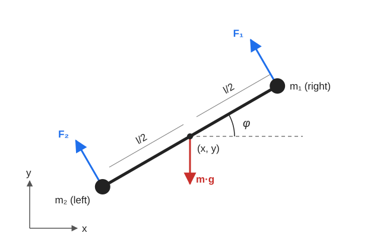

# Drone2D Dynamics

This page explains how the dynamics in [`Drone2D.py`](../Robot2DStudio/Robot/Models/Drone2D.py) are derived and how they are written in state-space form.

## Model

The drone moves in the `x-y` plane and is modeled as two point bodies joined by a rigid link.

Assumptions:

- The link has negligible mass and air area, so all mass and area are at the two ends.
- The two masses are equal, `m1 = m2`, so the center of mass is in the middle.
- Rotors produce thrust instantly, along the body's perpendicular direction. Their airflow is not modeled.
- Each input is held constant during an integration step.

Sign conventions: `y` points up, and `φ` is measured from the horizontal and is positive counterclockwise.

## State, input and parameters

$$
X = \begin{bmatrix} x & y & \varphi & \dot{x} & \dot{y} & \dot{\varphi} \end{bmatrix}^T
\qquad
u = \begin{bmatrix} F_1 & F_2 \end{bmatrix}^T
$$

`F1` is the right rotor and `F2` is the left rotor.

| Symbol | Code | Meaning |
|---|---|---|
| $l$ | `l` | Length from side to side |
| $m_1,\ m_2$ | `m1`, `m2` | Right and left mass |
| $m$ | `mTotal` | Total mass, $m_1 + m_2$ |
| $g$ | `g` | Gravity acceleration |
| $\rho$ | `rho` | Air density |
| $C_d$ | `cd` | Drag coefficient |
| $A_y$ | `Ay` | Total top area |
| $A_x$ | `Ax` | Total side area |

## Forces and torques

### Thrust and gravity

Thrust acts along the body's perpendicular direction, $(-\sin\varphi,\ \cos\varphi)$, and gravity acts downward:

$$
F_{thrust,x} = -(F_1 + F_2)\sin\varphi
\qquad
F_{thrust,y} = (F_1 + F_2)\cos\varphi
\qquad
F_{gravity,y} = -mg
$$

Each rotor is $l/2$ from the center, so the rotor torque is:

$$
\tau_{rotors} = \frac{l}{2}(F_1 - F_2)
$$

### Inertia

Both masses are $l/2$ from the center:

$$
I = m_1\left(\frac{l}{2}\right)^2 + m_2\left(\frac{l}{2}\right)^2 = \frac{m\,l^2}{4}
$$

### Translational drag

Drag is calculated separately for each axis. The area the air sees depends on the tilt:

$$
S_x(\varphi) = A_x|\cos\varphi| + A_y|\sin\varphi|
\qquad
S_y(\varphi) = A_y|\cos\varphi| + A_x|\sin\varphi|
$$

The drag force opposes the velocity. Using $|v|\,v$ instead of $v^2$ keeps its direction:

$$
F_{drag,x} = -\tfrac{1}{2}\rho C_d S_x(\varphi)|\dot{x}|\dot{x}
\qquad
F_{drag,y} = -\tfrac{1}{2}\rho C_d S_y(\varphi)|\dot{y}|\dot{y}
$$

### Rotational drag

Rotation moves each end perpendicular to the body, so only the top area resists it. First, find the body's velocity in that direction:

$$
v_\perp = -\dot{x}\sin\varphi + \dot{y}\cos\varphi
$$

Rotation adds $\frac{l}{2}\dot{\varphi}$ to the right end and subtracts it from the left end:

$$
v_R = v_\perp + \frac{l}{2}\dot{\varphi}
\qquad
v_L = v_\perp - \frac{l}{2}\dot{\varphi}
$$

Each end has area $A_y/2$, so it feels its own drag:

$$
F_R = -\tfrac{1}{2}\rho C_d \frac{A_y}{2}|v_R|v_R
\qquad
F_L = -\tfrac{1}{2}\rho C_d \frac{A_y}{2}|v_L|v_L
$$

An upward force on the right end turns the drone counterclockwise, and one on the left end turns it clockwise:

$$
\tau_{drag} = \frac{l}{2}(F_R - F_L)
= -\tfrac{1}{2}\rho C_d \frac{A_y}{2}\frac{l}{2}\left(|v_R|v_R - |v_L|v_L\right)
$$

This torque always opposes the spin, and it gets stronger when the drone also moves through the air. In a fall, the end rotating downward meets faster air than the other end, so it is pushed harder.

## Equations of motion

Newton's second law for translation and rotation gives:

$$
\ddot{x} = \frac{-(F_1 + F_2)\sin\varphi - \tfrac{1}{2}\rho C_d S_x(\varphi)|\dot{x}|\dot{x}}{m}
$$

$$
\ddot{y} = \frac{(F_1 + F_2)\cos\varphi - \tfrac{1}{2}\rho C_d S_y(\varphi)|\dot{y}|\dot{y}}{m} - g
$$

$$
\ddot{\varphi} = \frac{\frac{l}{2}(F_1 - F_2) + \tau_{drag}}{I}
$$

## State-space form

The code writes the model as:

$$
\dot{X} = A(X)\,X + B(X)\,u + E(X)
$$

The matrices depend on the state, so this is the **nonlinear** model written in matrix form, not a linear system.

Each term goes where it is multiplied:

| Term | Multiplies | Goes in |
|---|---|---|
| Velocities in the top rows | State | $A$ |
| Translational drag coefficients | State | $A$ |
| Thrust and rotor torque | Input | $B$ |
| Gravity | Nothing | $E$ |
| Rotational drag, $\tau_{drag}/I$ | Calculated directly | $E$ |

Using the coefficients:

$$
a_x = \frac{\tfrac{1}{2}\rho C_d S_x(\varphi)|\dot{x}|}{m}
\qquad
a_y = \frac{\tfrac{1}{2}\rho C_d S_y(\varphi)|\dot{y}|}{m}
$$

the matrices are:

$$
A = \begin{bmatrix}
0 & 0 & 0 & 1 & 0 & 0 \\
0 & 0 & 0 & 0 & 1 & 0 \\
0 & 0 & 0 & 0 & 0 & 1 \\
0 & 0 & 0 & -a_x & 0 & 0 \\
0 & 0 & 0 & 0 & -a_y & 0 \\
0 & 0 & 0 & 0 & 0 & 0
\end{bmatrix}
$$

$$
B = \begin{bmatrix}
0 & 0 \\
0 & 0 \\
0 & 0 \\
-\sin\varphi / m & -\sin\varphi / m \\
\cos\varphi / m & \cos\varphi / m \\
2 / (m\,l) & -2 / (m\,l)
\end{bmatrix}
\qquad
E = \begin{bmatrix}
0 \\ 0 \\ 0 \\ 0 \\ -g \\ \tau_{drag} / I
\end{bmatrix}
$$

The last row of $B$ comes from the rotor torque and inertia:

$$
\frac{l/2}{I} = \frac{l/2}{m\,l^2/4} = \frac{2}{m\,l}
$$

## Limitations

- **Diagonal motion:** drag is calculated per axis, so it can't tell moving edge-on from moving face-on at $\varphi = \pm 45°$.
- **Unequal masses:** the model is only valid for $m_1 = m_2$, because otherwise the center of mass moves away from the middle.
- **Rotor effects:** rotor airflow and motor response are not modeled.
- **Drag coefficient:** a single $C_d$ is used for every direction. It is an approximation and would need tuning against real data.
