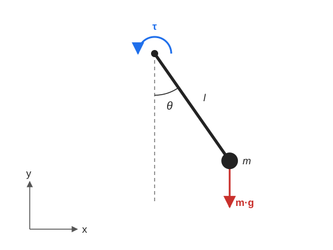

# Pendulum Dynamics

This page explains how the dynamics in [`Pendulum.py`](../Robot2DStudio/Robot/Models/Pendulum.py) are derived and how they are written in state-space form.

## Model

The pendulum swings in a plane around a fixed pivot, and is modeled as a point mass at the end of a rigid link.

Assumptions:

- The link has negligible mass, so all the mass is at its end.
- Damping is proportional to the angular velocity.
- Each input is held constant during an integration step.

Sign conventions: `θ` is measured from the downward vertical and is positive counterclockwise, so `θ = 0` is hanging straight down.

## State, input and parameters

$$
X = \begin{bmatrix} \theta & \dot{\theta} \end{bmatrix}^T
\qquad
u = \begin{bmatrix} \tau \end{bmatrix}
$$

`τ` is the torque applied at the pivot.

| Symbol | Code | Meaning |
|---|---|---|
| $l$ | `l` | Length of the link |
| $m$ | `m` | Mass |
| $g$ | `g` | Gravity acceleration |
| $b$ | `b` | Damping coefficient |

## Torques

All torques are taken around the pivot.

### Inertia

The mass is $l$ from the pivot:

$$
I = m\,l^2
$$

### Gravity

Only the part of the weight perpendicular to the link creates a torque. It pulls the mass back toward $\theta = 0$:

$$
\tau_{gravity} = -m\,g\,l\sin\theta
$$

### Damping

The damping torque opposes the rotation:

$$
\tau_{damping} = -b\,\dot{\theta}
$$

## Equation of motion

Newton's second law for rotation, $I\ddot{\theta} = \sum \tau$, gives:

$$
m\,l^2\,\ddot{\theta} = \tau - m\,g\,l\sin\theta - b\,\dot{\theta}
$$

Dividing by $m\,l^2$:

$$
\ddot{\theta} = -\frac{g}{l}\sin\theta - \frac{b}{m\,l^2}\dot{\theta} + \frac{1}{m\,l^2}\tau
$$

## State-space form

The code writes the model as:

$$
\dot{X} = A\,X + B\,u + E(X)
$$

Each term goes where it is multiplied:

| Term | Multiplies | Goes in |
|---|---|---|
| $\dot{\theta}$ in the top row | State | $A$ |
| Damping | State | $A$ |
| Input torque | Input | $B$ |
| Gravity, because of $\sin\theta$ | Calculated directly | $E$ |

The matrices are:

$$
A = \begin{bmatrix}
0 & 1 \\
0 & -\dfrac{b}{m\,l^2}
\end{bmatrix}
\qquad
B = \begin{bmatrix}
0 \\
\dfrac{1}{m\,l^2}
\end{bmatrix}
\qquad
E = \begin{bmatrix}
0 \\
-\dfrac{g}{l}\sin\theta
\end{bmatrix}
$$

$A$ and $B$ are constant, but $E$ depends on the state, so this is a **nonlinear** model.

## Limitations

- **Mass:** the link's mass and the size of the mass at its end are ignored.
- **Damping:** it is linear in $\dot{\theta}$. Real air drag grows closer to $\dot{\theta}^2$, and joints also have dry friction.
- **Input:** the torque is applied instantly, with no motor limits or response time.
